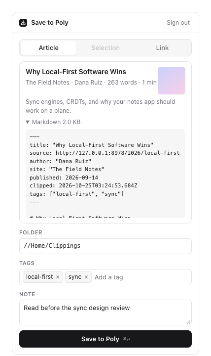
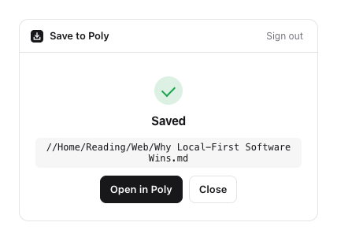
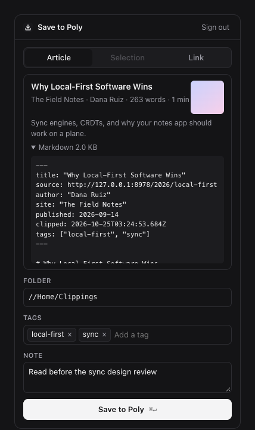

# Poly Clipper

[](https://github.com/areebhirani-beep/poly-clipper/actions/workflows/ci.yml)

A Chrome extension that saves what you're reading to your [Poly](https://poly.app) drive. Articles become clean Markdown files with the source, author and date in the frontmatter. Highlighted passages, images, links and PDFs can be saved too.

Poly lists a web clipper under "Planned" on its [roadmap](https://docs.poly.app/roadmap#web-clipper-browser-extension): "A browser extension for saving web content (articles, images, pages) directly to Poly from any website." This is a working version of that. It talks only to Poly's public MCP server (`mcp.poly.app`), so it needs no private API and no API key.

This is not an official Poly product.



| | |
| --- | --- |
|  |  |

## What it does

- **Article:** Mozilla's Readability (the engine behind Firefox Reader View) finds the article, and Turndown converts it to Markdown. Headings, links, tables and fenced code blocks (with their language) come through. Lazy-loaded images are resolved to their real URLs, every link is made absolute, and tracking parameters like `utm_source` and `fbclid` are removed from the saved source link.
- **Selection:** if you highlight text first, the clipper opens on just that passage and saves it with a "Clipped from" link back to the page.
- **Image:** right-click an image and choose "Save image to Poly". Poly downloads the file itself (`poly wget`), so nothing passes through the extension.
- **PDF:** on a PDF tab, Poly downloads the PDF and indexes its text, so it shows up in Poly search.
- **Link:** saves a bookmark file (`poly mkurl`) for pages you want to keep but not copy, like apps and dashboards.
- **Folder, tags and note:** folders are created if they don't exist, and Poly's folder list is suggested as you type. Tags accept Poly's color prefixes (`red:school`). The last folder and recent tags are remembered.
- **Never overwrites:** clipping the same page twice gives `Title (2).md`.
- **Shortcuts:** `Alt+Shift+S` opens the clipper. `Alt+Shift+D` saves the page (or the highlighted passage) straight to the last folder, without opening anything. You can change both at `chrome://extensions/shortcuts`.

A saved article looks like this:

```markdown
---
title: "Why Local-First Software Wins"
source: https://fieldnotes.example/2026/local-first
author: "Dana Ruiz"
site: "The Field Notes"
published: 2026-09-14
clipped: 2026-10-24T20:23:01.296Z
tags: ["local-first", "sync"]
---

# Why Local-First Software Wins

Most apps you use every day keep your data on someone else's computer...
```

## How it talks to Poly

Sign-in is OAuth with PKCE, using the endpoints from `poly.app/.well-known/oauth-authorization-server`. On first use, the extension registers itself as a client with its own `chrome.identity` redirect URL, then sends you to poly.app to sign in with PKCE. The extension never sees your password, only a token, which it refreshes when it expires. "Sign out" revokes it.

Every action is one call to the MCP server's `cli` tool, using the same arguments as the desktop `poly` command:

| Action | Command |
| --- | --- |
| Make the folder | `mkdir //Home/Clippings` (each missing level; "already exists" counts as success) |
| Save an article or selection | `file write <path> --text <markdown> --no-clobber` |
| Add tags and the note | `file update <path> --tag ... --notes ...` |
| Get the "Open in Poly" link | `file show <path> --output json` |
| Save an image or PDF | `wget <url> -P <folder> --tag ... --notes ...` |
| Save a link | `mkurl <folder> <url>` |
| Suggest folders | `ls //Home --output json` |

Arguments are sent as a JSON array, never as a shell string, so titles with quotes, slashes or emoji don't need escaping.

## Install

Needs Node 24 or later.

```bash
npm install
npm run build
```

Then open `chrome://extensions`, turn on Developer mode, click "Load unpacked" and pick the `dist` folder. Click the toolbar button and choose "Connect Poly".

## Tests

```bash
npm test        # unit tests (Vitest)
npm run e2e     # loads the built extension into Chromium and drives the popup
npm run check   # typecheck, both test suites, release build
```

The end-to-end run points the extension at `scripts/mock-poly.ts`, a local server that speaks the same streamable-HTTP MCP as `mcp.poly.app` and keeps files in memory, then saves articles, highlights, links and images through the real popup. One of its pages sends `require-trusted-types-for 'script'`, the CSP GitHub and Google use, which is why the code that runs inside pages builds DOM nodes instead of assigning `innerHTML`. The screenshots above come from that run.

## Limits

- **Not yet run against a real Poly account.** Poly's sign-up needs an invite code. Everything here follows Poly's public docs and its live OAuth metadata. I checked that Poly's registration endpoint accepts a `chromiumapp.org` redirect URL. The save flow was tested against the mock server, not poly.app.
- The JSON shape of `ls --output json` and `file show --output json` isn't documented, so both are read defensively. If they don't match, folder suggestions and the "Open in Poly" button are hidden and saving still works.
- Images and PDFs behind a login can't be saved, because Poly downloads them from its own servers without your cookies.
- Images and PDFs keep the file name from their URL. Poly's docs don't say whether `wget` has a no-overwrite option, so two different `image.jpg` files saved to the same folder may replace each other. Articles and highlights never overwrite.
- Chrome doesn't let extensions read its own pages. On the Web Store only Link works, and on `chrome://` pages there is nothing to save. The shortcut reports that with a badge on the toolbar button, since it can't show a toast there.

## License

MIT
